> **Sift is a Linux port of [Burrow](https://github.com/caezium/Burrow)** by
> [caezium](https://github.com/caezium) — the open-source system companion for macOS.
> All credit for the original design, product idea and macOS app goes to the Burrow
> project. Sift re-implements it from scratch in Rust + GTK4 for Linux desktops; it
> contains no Burrow code and is not affiliated with or endorsed by the Burrow authors.
> If you're on a Mac, use Burrow: `brew install --cask caezium/tap/burrow`.

<div align="center">
  
  <h1>sift</h1>
  <p><em>The open-source system companion for your Linux desktop — clean, uninstall, analyze, optimize, and monitor, in one native app.</em></p>
</div>

<p align="center">
  <a href="https://github.com/jeevansai-k/sift/releases"></a>
  
  
  
  <a href="https://github.com/caezium/Burrow"></a>
</p>

**Sift puts everything your Linux machine needs in one free, native app: junk and cache cleanup, dev-artifact purge, leftover-installer sweep, app uninstall with leftover removal, duplicate finding, safe maintenance, disk maps, open ports, health checks and a live system dashboard with local history. Everything that deletes is preview-first and reviewed, goes to the Trash by default, and admin cleanups ask for your password once — after showing you the exact commands.**

```bash
# Debian / Ubuntu / Pop!_OS
wget https://github.com/jeevansai-k/sift/releases/latest/download/sift_0.1.0_amd64.deb
sudo apt install ./sift_0.1.0_amd64.deb
```

## Contents

- [Screenshots](#screenshots)
- [The tools](#the-tools)
- [Burrow → Sift](#burrow--sift)
- [Safety](#safety)
- [Install](#install)
- [Command line](#command-line)
- [Settings & data](#settings--data)
- [Build from source](#build-from-source)
- [Architecture](#architecture)
- [Not included yet](#not-included-yet)
- [Credits & license](#credits--license)

## Screenshots

<table>
  <tr>
    <td>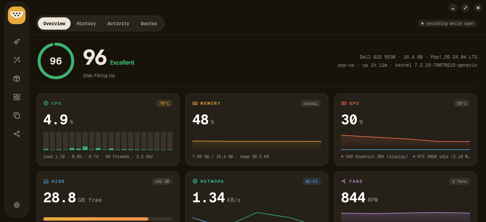</td>
    <td>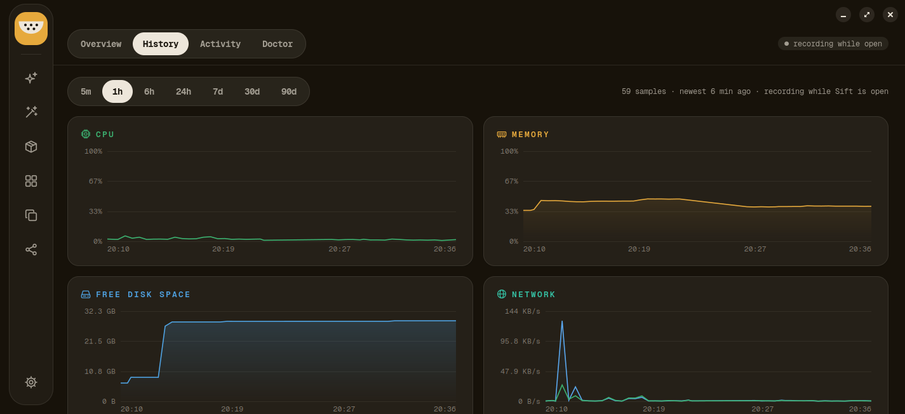</td>
  </tr>
  <tr>
    <td>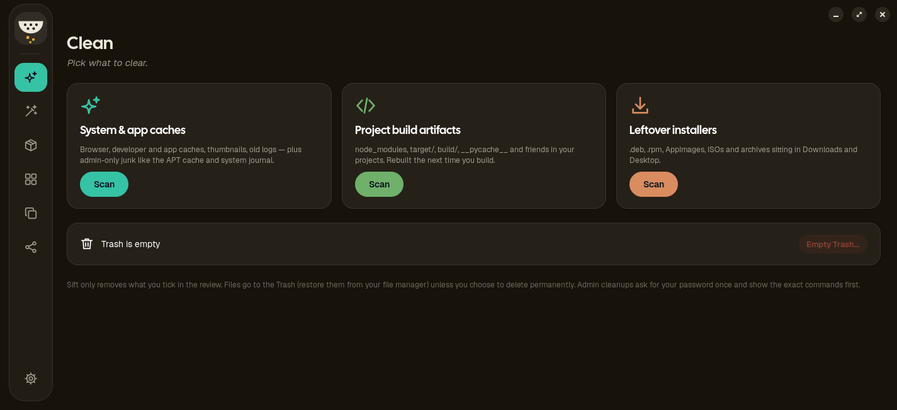</td>
    <td>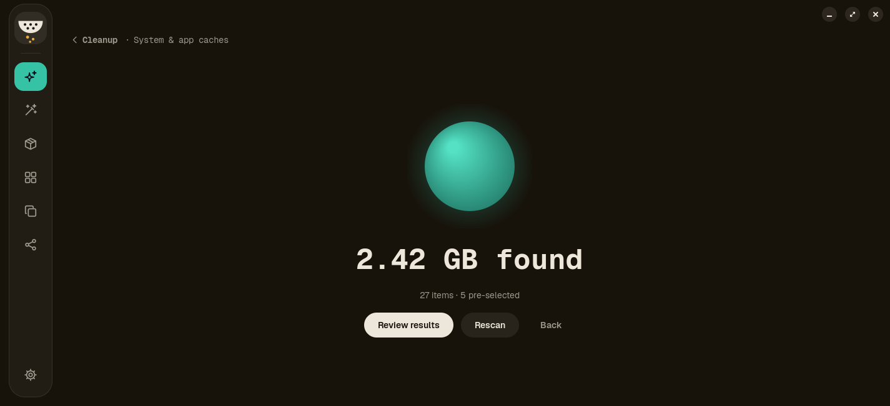</td>
  </tr>
  <tr>
    <td>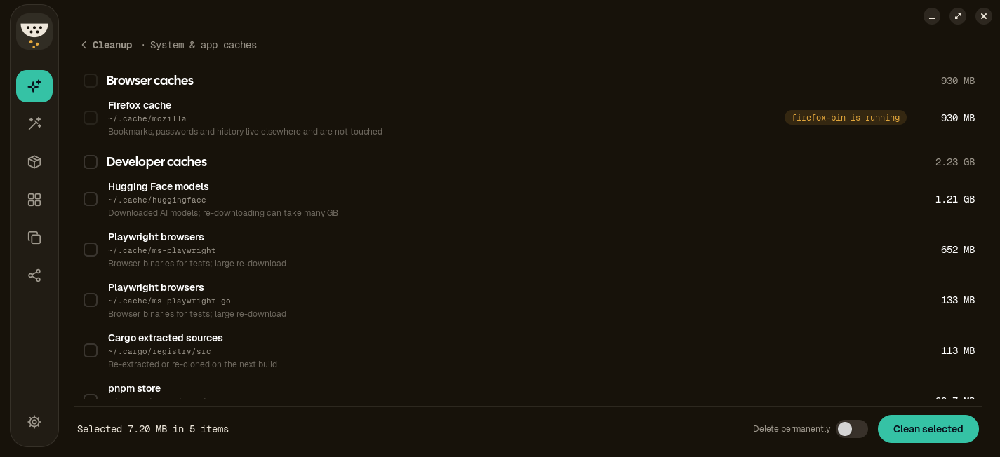</td>
    <td>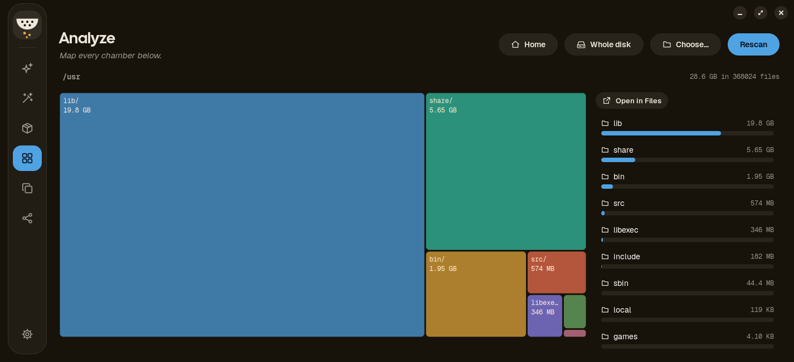</td>
  </tr>
  <tr>
    <td>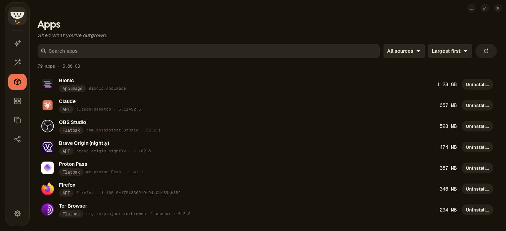</td>
    <td>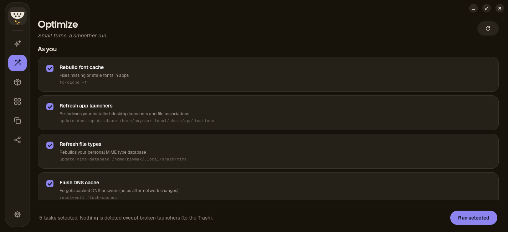</td>
  </tr>
  <tr>
    <td>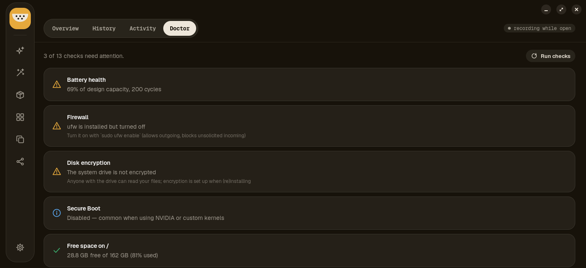</td>
    <td>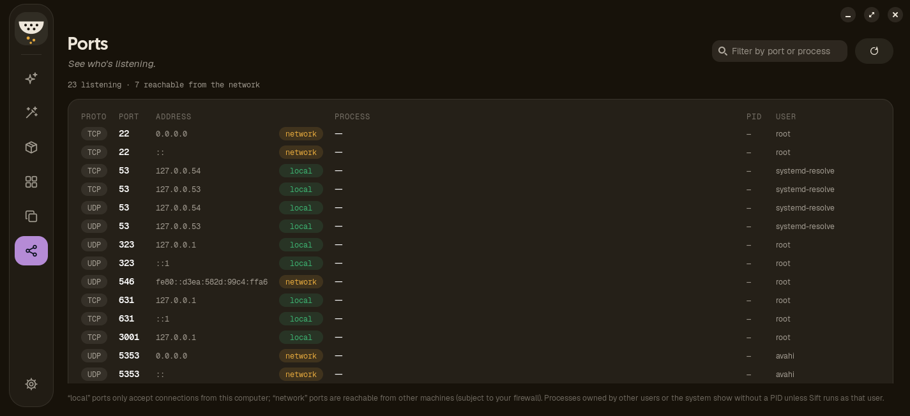</td>
  </tr>
  <tr>
    <td>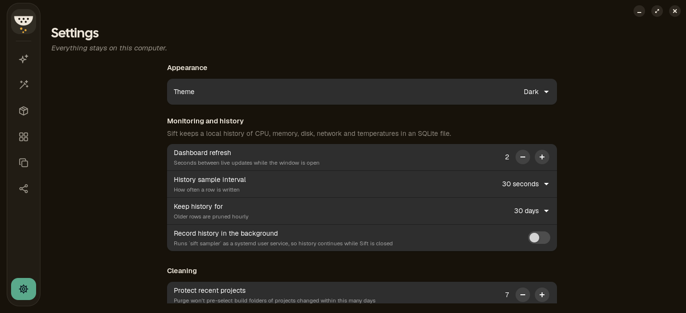</td>
    <td></td>
  </tr>
</table>

## The tools

| Tool | What it does | CLI |
|---|---|---|
| **Monitor · Overview** | Live CPU (per-core, load, temperature, clock), memory with kernel pressure-stall info, every GPU (Intel/AMD load from DRM counters, NVIDIA via `nvidia-smi` — skipped while a laptop dGPU sleeps), disk free + I/O, network, fans, battery health; a 0–100 health score with a one-line reason; top processes. | `sift status` |
| **Monitor · History** | Charts from 5 minutes to 90 days out of a local SQLite history, plus the busiest processes in the range. | `sift history` |
| **Monitor · Activity** | Every clean, purge, uninstall and maintenance run, with the exact paths it touched. | `sift activity` |
| **Monitor · Doctor** | Disk headroom, memory pressure, failed systemd services, pending restart / newer kernel, updates, firewall, Secure Boot, disk encryption, battery, temperatures, boot errors, clock sync, Trash size. | `sift doctor` |
| **Clean** | Browser caches (skipped while the browser runs), developer caches (pip, uv, npm, Yarn, pnpm, Go, Cargo, Gradle…), Electron app caches, Flatpak/Snap app caches, thumbnails, old logs, the Trash. **Admin items:** APT cache, journal vacuum, old Snap revisions, crash reports, rotated logs. | `sift clean` |
| **Purge** | `node_modules`, `target/`, `build/`, `dist/`, `__pycache__`, `.venv`, `.next`, `.gradle`… — only next to the project file that produces them; recently changed projects aren't pre-selected. | `sift purge` |
| **Installers** | `.deb`, `.rpm`, AppImages, `.run`, Flatpak refs, ISOs, foreign installers and archives in Downloads / Desktop. | `sift installer` |
| **Optimize** | Font, icon, MIME and launcher caches, DNS flush, failed user services, broken launchers, unused Flatpak runtimes; as admin: SSD TRIM, `updatedb`, unneeded APT packages. | `sift optimize` |
| **Apps** | APT, Flatpak, Snap, AppImage and local apps with sizes. Uninstall previews the exact command, what APT would also remove, and leftover folders to tick. Desktop-critical packages are protected. | `sift apps`, `sift uninstall` |
| **Analyze** | Squarified treemap of any folder or the whole disk; drill in, open in Files. Read-only. | `sift analyze` |
| **Duplicates** | Identical files by content (size → partial → full BLAKE3); keeps one copy of everything. | `sift dupes` |
| **Ports** | Listening TCP/UDP ports, local vs. network-reachable, owning process; stop your own processes. | `sift ports` |

## Burrow → Sift

Sift keeps Burrow's product shape — the floating tool rail, Monitor sections, the Clean hub,
scan → "X found" → review flow, warm espresso palette with per-tool accents, Geist and Cal Sans type,
and the preview-first safety model — and maps each macOS mechanism to its Linux counterpart:

| Burrow (macOS) | Sift (Linux) |
|---|---|
| `~/Library/Caches`, logs | XDG `~/.cache`, browser and developer caches, Electron caches, Flatpak/Snap caches |
| `.dmg` / `.pkg` installers | `.deb`, `.rpm`, AppImage, `.run`, `.flatpakref`, ISO |
| `.app` uninstall + `~/Library` leftovers, Homebrew | APT, Flatpak, Snap, AppImage + `~/.config`, `~/.local/share`, `~/.var/app`, `~/snap` leftovers |
| Rebuild caches, flush DNS, restart Dock | `fc-cache`, desktop/MIME/icon caches, `resolvectl flush-caches`, `fstrim`, `apt autoremove` |
| SIP / Gatekeeper / FileVault / Time Machine checks | failed systemd units, ufw/firewalld, Secure Boot, LUKS, reboot-required, apt updates |
| macOS admin dialog / privileged helper | one `pkexec` prompt per confirmed batch of fixed commands |
| Menu-bar HUD, MCP server, Sparkle updates | not yet — see [Not included yet](#not-included-yet) |

## Safety

- **Preview first.** Every cleanup is scan → review → confirm; the CLI is a dry run unless you pass `--apply`.
- **Only what you reviewed.** Removal takes exactly the ticked items (or a `--plan` file), re-checks each, and never re-scans or widens.
- **Rails on every path:** absolute and normalized, no symlinks in the path, inside the folders that tool may touch, never a protected location (system folders, your home and XDG roots, `~/.ssh`, `~/.gnupg`, keyrings, password stores, browser profiles…), never on your never-clean list, only files you own.
- **Trash by default** (freedesktop.org Trash, restorable from your file manager). Permanent delete and emptying the Trash each need their own confirmation.
- **In-use guard:** caches open in a running program are skipped.
- **Admin actions** never run in the background: you see the exact commands, then one `pkexec` password prompt. Nothing you type reaches a root shell.
- **Receipts:** every removal is logged in Activity. Sift sends nothing anywhere — no telemetry.

## Install

### Debian, Ubuntu, Pop!_OS, Linux Mint (`.deb`)

Download `sift_<version>_amd64.deb` from [Releases](https://github.com/jeevansai-k/sift/releases), then:

```bash
sudo apt install ./sift_0.1.0_amd64.deb
```

Remove it with `sudo apt remove sift`.

### Any distro (portable `.tar.gz`, no root)

Needs GTK 4.14+ and libadwaita 1.5+ from your distribution.

```bash
tar xzf sift-0.1.0-linux-x86_64.tar.gz
cd sift-0.1.0-linux-x86_64
./install.sh          # installs into ~/.local
```

## Command line

```bash
sift status              # live snapshot (--json for one JSON envelope, --watch for a stream)
sift clean               # what's reclaimable (dry run); --apply moves pre-selected items to the Trash
sift clean --system      # include admin items (run only with --apply --all, after a pkexec prompt)
sift purge --root ~/code # build artifacts in your projects
sift installer           # leftover installers in Downloads/Desktop
sift optimize            # maintenance tasks with exact commands; --apply runs the pre-selected ones
sift apps                # installed apps with ids, sources and sizes
sift uninstall APP_ID    # preview; --apply [--leftovers] to do it
sift analyze ~/Videos --depth 2
sift dupes ~/Pictures ~/Downloads
sift ports
sift doctor
```

`--plan FILE` (clean / purge / installer) removes only the absolute paths listed in FILE, each re-validated.
`--permanent` skips the Trash. `--stream` prints one JSON event per line.

## Settings & data

| What | Where |
|---|---|
| Settings | `~/.config/sift/settings.json` |
| History & activity (SQLite) | `~/.local/state/sift/sift.db` |
| Background history service | Settings → *Record history in the background* (a systemd **user** service running `sift sampler`) |

## Build from source

```bash
sudo apt install -y build-essential pkg-config libgtk-4-dev libadwaita-1-dev
curl --proto '=https' --tlsv1.2 -sSf https://sh.rustup.rs | sh -s -- -y --profile minimal
git clone https://github.com/jeevansai-k/sift.git && cd sift
make test        # engine tests (destructive paths run only in sandbox homes)
make install     # builds and installs into ~/.local
packaging/build-release.sh   # .deb + .tar.gz into dist/
```

## Architecture

```
crates/sift-core   engine, no GUI deps: /proc & /sys status, SQLite history, cleanup engines,
                   freedesktop Trash, path rails, pkexec batches, apps, analyze, dupes, ports, doctor
crates/sift-cli    `sift` — the engine from the terminal ({ok, data|error} JSON envelope,
                   NDJSON streams) and the background history sampler
crates/sift-gui    `sift-gui` — GTK4 + libadwaita app; engine work runs on worker threads
data/              desktop entry, icons, bundled fonts (OFL), systemd user unit
packaging/         release script for .deb and .tar.gz
```

`SIFT_HOME=/some/dir` points the whole engine at a sandbox home — that's how cleanup is tested
without touching a real one.

## Not included yet

Compared with Burrow on macOS: the MCP / AI-agent server and local HTTP API, a tray icon,
an app-updates tab, startup-item management, notifications, similar-photo detection and per-app
network usage. Contributions welcome.

## Credits & license

- **[Burrow](https://github.com/caezium/Burrow)** by **caezium** (MIT) — the original macOS app.
  Sift's design, layout, palette, tool set and safety model come from Burrow. Thank you!
- **[Mole](https://github.com/tw93/Mole)** (`mo`) by **tw93** (MIT) — the command model Burrow is built around.
- Squarified treemap: Bruls, Huijsen & van Wijk (2000), re-implemented from the paper.
- Fonts: Geist and Geist Mono (Vercel) and Cal Sans, SIL Open Font License 1.1.

Sift is MIT licensed — see [LICENSE](LICENSE) and [NOTICE](NOTICE). Sift's name and icon are its own.
